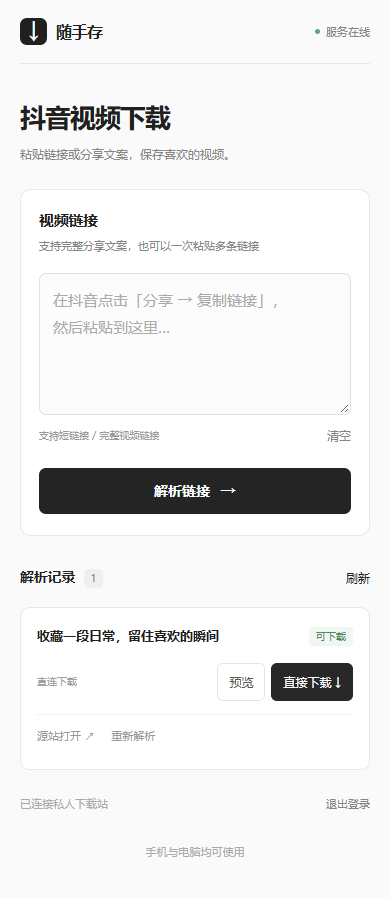

# 随手存 · 抖音视频下载

新增 **设备直连版**：电脑双击 `启动手机远程版.lnk`，其他人的电脑或手机也可凭密码访问，解析后从视频源站直接下载。你的电脑只解析地址，不下载、不缓存、不转发视频正文。详见 [手机远程版使用说明](手机远程版使用说明.md)。下文描述的原桌面版本仍支持下载到电脑。

## 从源码运行

需要 Windows、Python 3.12，以及 Edge 或 Chrome。

```powershell
# 在项目目录中安装 Python 依赖
powershell -ExecutionPolicy Bypass -File .\安装依赖.ps1

# 获取并校验 Cloudflare 官方远程连接组件
powershell -ExecutionPolicy Bypass -File .\准备远程版.ps1

# 启动设备直连网页服务
.\.venv\Scripts\python.exe remote_app.py

# 或仅在本机测试网页
.\.venv\Scripts\python.exe remote_app.py --local-only

# 启动传统桌面下载器
.\.venv\Scripts\python.exe app.py
```

远程版窗口显示访问网址、二维码和访问密码；首次启动随机生成密码。临时网址在重启隧道后可能变化，电脑需持续开机并运行服务。直连视频是否可用取决于视频源站，不保证每条链接或任意网络都可下载。

仓库只包含源码、依赖清单、构建脚本与界面预览，不包含本机密码、登录 Cookie、视频样本、虚拟环境或打包 EXE。源文件中的快捷方式说明适用于本机已打包版本；从 GitHub 克隆后请使用上述命令启动或自行打包。

## 在 Linux 服务器上运行（网页版）

桌面版和远程版控制面板是 Windows 专用（Tkinter + PowerShell）。Linux 服务器上使用无头入口 `linux_server.py`，运行的是同一套网页服务（Flask + Waitress）：

```bash
# 需要 Python 3.12
./run_linux.sh                # 自动建 .venv、装依赖与 Playwright Chromium，再启动服务
# 或手动：
python3 -m venv .venv && .venv/bin/pip install -r requirements.txt
.venv/bin/python -m playwright install chromium   # 浏览器解析回退用，无头运行
.venv/bin/python linux_server.py --port 7860      # 默认只监听 127.0.0.1
```

- 访问密码：首次启动随机生成，保存在数据目录的 `remote-access.json` 并打印到服务控制台；也可以用环境变量 `DOUYIN_ACCESS_PASSWORD` 指定。数据目录在 Linux 上为 `$XDG_DATA_HOME/DouyinLocalDownloader`（默认 `~/.local/share/DouyinLocalDownloader`），可用 `DOUYIN_DATA_DIR` 覆盖。
- 对外访问：和 Windows 版一样走隧道/反向代理，不要把端口直接暴露到公网。`./run_linux.sh --with-tunnel` 会在本机已安装 `cloudflared` 时同时拉起 Cloudflare 快速隧道，打印 `https://*.trycloudflare.com` 临时网址（重启后变化）。
- 无头服务器上无法弹出浏览器做人工登录/验证，抖音要求登录时请先在桌面端完成登录再同步浏览器配置目录，或改用分享页/yt-dlp 两级解析可直接处理链接。

## 使用

源码版运行 `.\.venv\Scripts\python.exe app.py`。本机已打包版本可双击 **启动抖音下载器.lnk**，或进入 `dist\抖音视频下载器` 双击 **抖音视频下载器.exe**。

1. 在抖音中选择“分享 → 复制链接”。
2. 点击程序里的“粘贴剪贴板”；整段分享文案也可以直接粘贴，多条链接可一起输入。
3. 选择保存位置，点击“开始下载”。默认保存在 Windows 用户目录的 `Downloads\抖音视频`。
4. 完成后点击“打开文件夹”查看 MP4 文件。

如果弹出抖音浏览器，请保持窗口打开，程序会自动尝试解析。若页面要求登录或验证，在该窗口内完成即可。也可以先点击“登录抖音 / 更新登录状态”，登录后关闭浏览器，再开始下载。程序不要求手工复制 Cookie。需要已安装 Edge 或 Chrome。

## 已实现

- 支持 `v.douyin.com` 分享短链、`douyin.com/video/编号`、带 `modal_id` 的视频网址，以及多条分享文案。
- 分享页直接解析、yt-dlp 解析、真实浏览器解析逐级尝试；视频从平台返回的地址直接下载，无第三方解析服务。
- 显示队列状态、进度、下载速度、错误原因；可取消当前任务和剩余队列。
- 以视频标题和作品编号命名，重名时自动加序号，保留原文件。
- 写入临时文件，检查 MP4 文件头和传输长度，完成后再改名；失败或取消清理临时文件。
- 浏览器解析只接受当前作品编号的数据，避免保存推荐视频。

## 登录状态与限制

独立浏览器登录状态、保存目录设置存放在 `%LOCALAPPDATA%\DouyinLocalDownloader`，不会打包进程序，不会上传到解析服务。不要分享此目录。如需退出登录，可在独立浏览器内退出；关闭程序及其浏览器后删除该目录可重置所有设置。

仅支持单个视频作品及其批量链接；图文、直播、账号主页、付费或无访问权限作品不在此版本范围内。抖音可能要求人工登录、验证码或调整接口，因此无法保证任意链接始终能下载。默认尝试平台提供的 H.264 MP4 和较高画质，不承诺固定分辨率或去水印。请下载你有权保存的内容。

取消过程中，正在等待的网络请求最多可能需要约 20 秒退出，浏览器初次导航最多约 35 秒；请等待任务状态更新。完成的队列文件不会被删除。一次只运行一个实例，避免独立浏览器配置目录被同时占用。

## 开发与维护

使用 Python 3.12 和 PowerShell。安装脚本会创建 `.venv`；已打包版本无需安装 Python。

```powershell
# 源码启动
.\.venv\Scripts\python.exe app.py

# 命令行下载
.\.venv\Scripts\python.exe app.py --url 'https://www.douyin.com/video/作品编号' --output 'D:\我的视频'

# 测试
.\.venv\Scripts\python.exe -m unittest discover -s tests -v

# 重新安装依赖 / 打包
powershell -ExecutionPolicy Bypass -File .\安装依赖.ps1
powershell -ExecutionPolicy Bypass -File .\打包.ps1
```

`requirements.txt` 固定本次验证使用的依赖版本；日后抖音接口变化时可更新 yt-dlp / Playwright 并重新打包。直接升级虚拟环境不会更新已打包 EXE。

开源项目来源和第三方许可证参见 [开源说明](开源说明.md)。验证方法与适用范围参见 [测试说明](TESTING.md)。

## 界面预览


